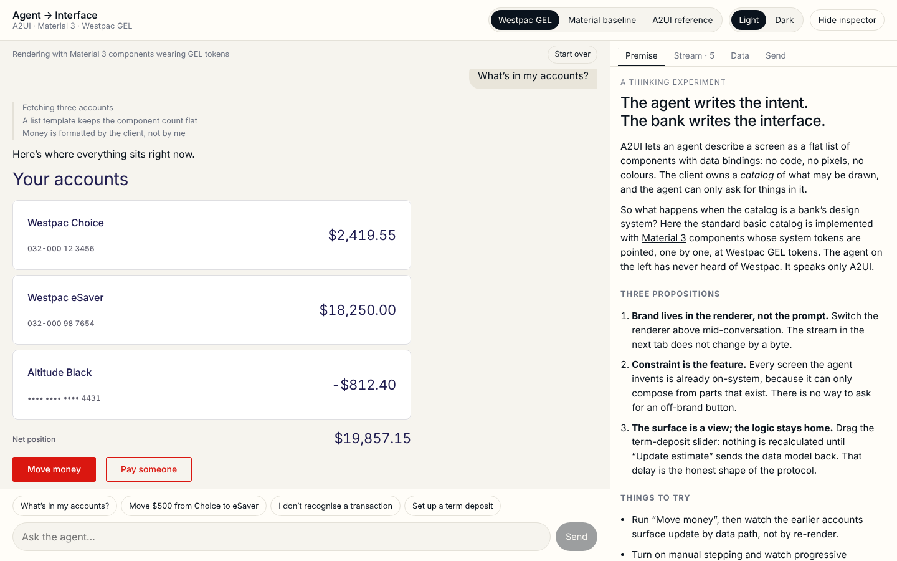
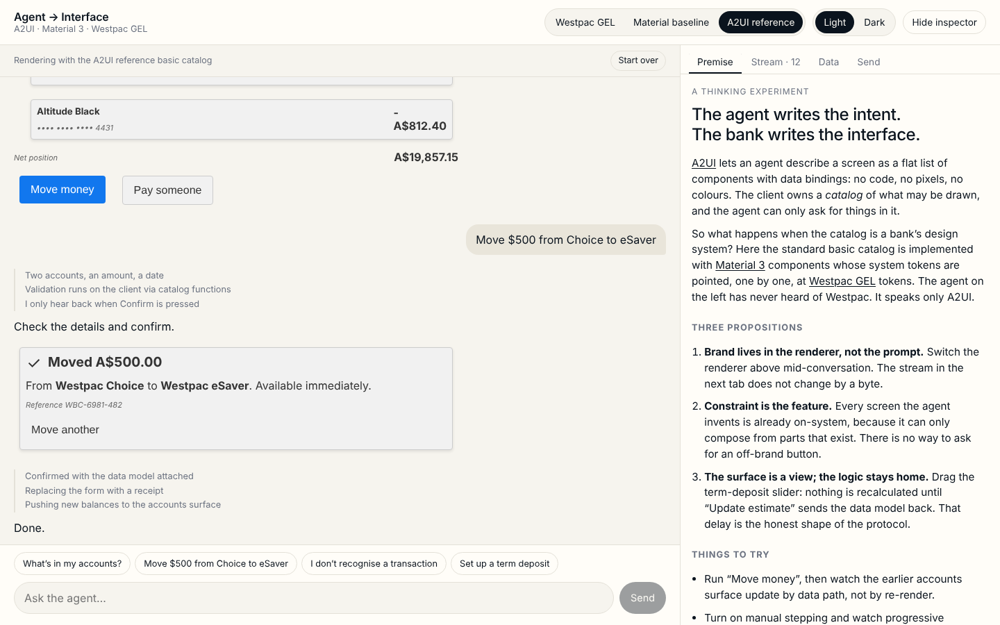
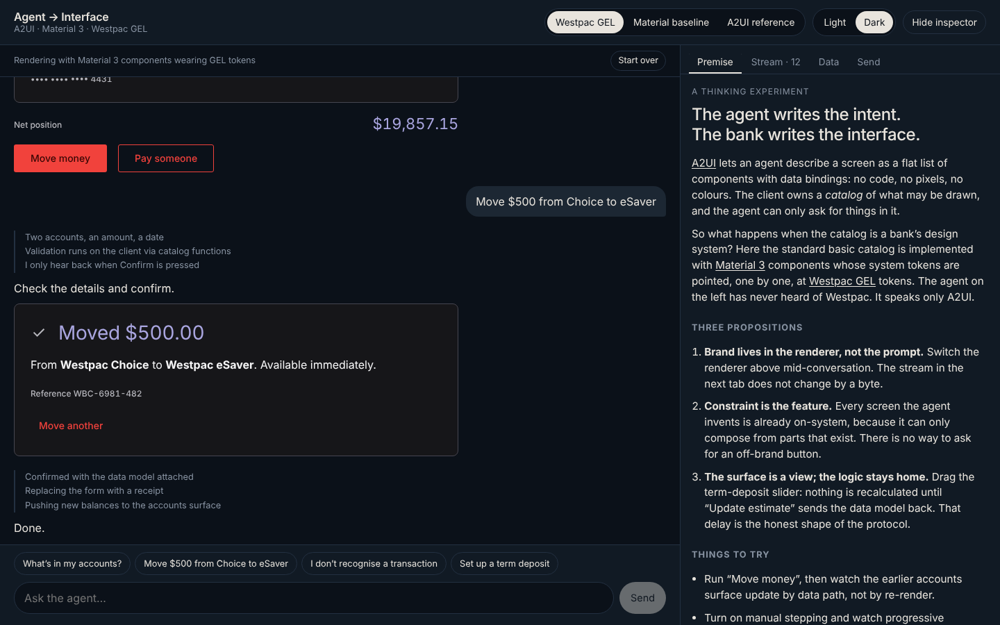

# Agent → Interface

**A2UI × Material 3 × Westpac GEL.** A thinking experiment, built to run.

An agent that speaks only [A2UI](https://a2ui.org) (Google's Agent-to-User
Interface protocol) composes banking screens out of the standard basic
catalog. The catalog is implemented with [Material Web](https://github.com/material-components/material-web)
components whose Material 3 system tokens are mapped, one by one, onto
[Westpac GEL](https://github.com/WestpacGEL/GEL-next) design tokens pulled from
the published `@westpac/style-config` package. The agent has never heard of
Westpac. Flip the renderer and the stream does not change by a byte.

Needs Node 22 (or 20.19+); there is an `.nvmrc`.

```
npm install
npm run dev        # http://localhost:5173
npm run build      # tokens → typecheck → dist/
npm run preview && node scripts/smoke.cjs   # headless run of all four scenarios
```

| Material 3 wearing GEL | Same stream, A2UI reference renderer |
| --- | --- |
|  |  |



## What is in the box

| Path | What it does |
| --- | --- |
| `scripts/gel-tokens.mjs` | Walks the W3C token tree in `@westpac/style-config` and emits `src/theme/gel-wbc.generated.css` (`--gel-*`). References are kept as `var()` chains so the semantic → primitive lineage survives into devtools. |
| `src/theme/m3-westpac.css` | Points every `--md-sys-color-*`, shape and typeface token at a GEL token. Two skins (`data-skin="westpac" \| "baseline"`) and a derived dark scheme. |
| `src/catalog/` | The A2UI basic catalog (Text, Image, Icon, Row, Column, List, Card, Tabs, Modal, Divider, Button, TextField, CheckBox, ChoicePicker, Slider, DateTimeInput) implemented as light-DOM Lit elements wrapping `md-*` components. Registered under the basic catalog's own id. |
| `src/agent/` | A scripted agent. It replies with A2UI envelopes and reacts to the actions surfaces send back (confirm a transfer, lodge a dispute, re-estimate a term deposit). Everything it says is fictional. |
| `src/app/` | The page: a transcript on the left where surfaces render inline, an inspector on the right with the premise, the raw JSONL stream, each surface's live data model, and a box to send your own envelopes. |

## The experiment

1. **Brand lives in the renderer, not the prompt.** Three renderers share one
   stream: Material 3 wearing GEL, Material 3 baseline, and the A2UI reference
   basic catalog.
2. **Constraint is the feature.** The agent can only compose from the catalog,
   so every screen it invents is already on-system.
3. **The surface is a view; the logic stays home.** Dragging the term-deposit
   slider changes nothing until "Update estimate" sends the data model back.

Things to try: run "Move money" and watch the earlier accounts surface update
by data path; turn on manual stepping to see progressive rendering; edit a data
model in the Data tab; paste basic-catalog JSONL into Send.

## Seams, honestly

- GEL-next ships light mode only. The dark scheme here is derived from the same
  primitives and should be read as a proposal.
- The Westpac typeface is licensed and not included. Headings declare it and
  fall back to the system stack.
- Icons are Material Symbols standing in for the GEL icon set
  (`src/catalog/icons.ts` is the seam).
- `@westpac/style-config` publishes no licence field; the old GEL repo was
  GPL-3.0. Only token *values* are consumed here, at build time, from the npm
  package. Check before shipping anything commercial.
- A2UI is an early public preview (`@a2ui/web_core` 0.14, protocol v0.9).

## Wiring a real agent

`MockAgent` in `src/agent/agent.ts` has two methods: `respond(text)` and
`respondToAction(action)`, both returning `{say?, thinking?, messages}`. Replace
it with anything that yields A2UI v0.9 envelopes (A2A, AG-UI, an SSE endpoint, a
Claude tool call that returns JSONL) and the rest of the page is unchanged.

Stack: Lit 3, `@a2ui/web_core` + `@a2ui/lit` 0.14, `@material/web` 2.5,
`@westpac/style-config` 1.0, Vite 8, TypeScript 5.9.
